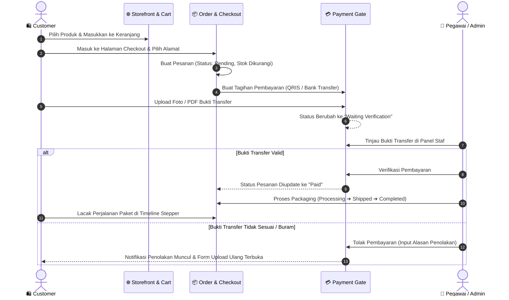

<div align="center">

# 🛍️ Agno Store — Modern E-Commerce Platform

<p align="center">
  
</p>

[](https://laravel.com)
[](https://php.net)
[](https://tailwindcss.com)
[](https://alpinejs.dev)
[](https://www.sqlite.org)
[](LICENSE)

<br/>

<p align="center">
  <b>Agno Store</b> adalah platform e-commerce monolitik modern berbasis <b>Laravel 12</b> yang dirancang dengan sistem <b>Multi-Role Authentication</b> (<i>Administrator</i>, <i>Pegawai Gudang</i>, dan <i>Customer</i>). Dilengkapi sistem manajemen pesanan terpadu, pembayaran berbasis <b>QRIS</b> & <b>Transfer Bank</b> dengan verifikasi bukti transfer instan, serta pelacakan pesanan visual 5-tahap secara real-time.
</p>

<p align="center">
  <a href="#-fitur-utama">✨ Fitur Utama</a> •
  <a href="#-arsitektur-multi-role">👥 Multi-Role</a> •
  <a href="#-alur-transaksi">🔄 Alur Transaksi</a> •
  <a href="#%EF%B8%8F-tech-stack">🛠️ Tech Stack</a> •
  <a href="#-persyaratan-sistem">📋 Persyaratan</a> •
  <a href="#-panduan-instalasi--setup">🚀 Cara Instalasi</a> •
  <a href="#-kredensial-akun-demo">🔑 Akun Demo</a> •
  <a href="#-struktur-direktori">📁 Struktur Direktori</a>
</p>

<hr style="border: 1px solid #e5e7eb;" />

</div>

<br/>

## 🌟 Highlight Tampilan & Pengalaman Pengguna

```
 ┌────────────────────────────────────────────────────────────────────────┐
 │  🟢 AGNO STORE - NEXT GENERATION SHOPPING EXPERIENCE                   │
 ├────────────────────────────────────────────────────────────────────────┤
 │  🛒 Storefront Modern   │ Katalog responsif, pencarian cepat & filter │
 │  📦 Order Tracking      │ 5-Stage Stepper: Pending ➔ Selesai          │
 │  💳 Seamless Payments   │ QRIS Scanner Mockup + Bank Transfer Upload  │
 │  🛡️ Role Security       │ Policy-driven Dashboard (Admin/Pegawai/User) │
 └────────────────────────────────────────────────────────────────────────┘
```

---

## ✨ Fitur Utama

### 🛍️ 1. Storefront & Customer Experience (`Role: User`)
* **Katalog Interaktif**: Menampilkan produk unggulan, daftar kategori dinamis, pencarian produk instan, dan filter kategori.
* **Halaman Rincian Produk**: Informasi stok real-time, spesifikasi berat, galeri foto, deskripsi lengkap, serta rekomendasi produk terkait.
* **Keranjang Belanja Pintar**: Tambah/kurang kuantiti, kalkulasi subtotal instan, pengecekan validasi stok otomatis, dan penghapusan item.
* **Buku Alamat Pengiriman (Address Book)**: Kelola banyak alamat pengiriman sekaligus (label, nama penerima, nomor HP, detail alamat, kota, provinsi, kode pos, dan penanda alamat utama).
* **Checkout Terpadu**: Pemilihan alamat tujuan, input catatan kurir/penjual, dan penghitungan tagihan transparan dengan sistem locking stok transaksi.
* **Pembayaran QRIS & Transfer Bank**:
  * Tampilan kode QRIS instan dengan NMID resmi toko.
  * Nomor rekening Bank BCA & Mandiri untuk transfer manual.
  * Form upload bukti transfer (JPG, PNG, PDF maks. 5 MB) dengan **instant preview file**.
  * Notifikasi status pembayaran: *Menunggu Pembayaran*, *Menunggu Verifikasi*, *Terverifikasi (Lunas)*, atau *Ditolak* (disertai alasan penolakan dan tombol upload ulang).
* **Timeline Pelacakan Pesanan 5-Tahap**:
  $$\text{Menunggu Bayar} \longrightarrow \text{Terverifikasi} \longrightarrow \text{Diproses Gudang} \longrightarrow \text{Dalam Pengiriman} \longrightarrow \text{Pesanan Selesai}$$

---

### 👷 2. Panel Operasional & Gudang (`Role: Pegawai`)
* **Dashboard Operasional**: Ringkasan metrik pesanan masuk, antrean pembayaran yang butuh diverifikasi, dan pesanan dalam pengiriman.
* **Kelola Antrean Pesanan**:
  * Filter pesanan yang siap diproses (*Paid*, *Processing*, *Shipped*).
  * Cetak/periksa daftar barang (*picking & packaging list*), kuantiti barang, dan alamat penerima.
  * Update status pesanan langsung (*Sedang Diproses Gudang*, *Diserahkan ke Kurir*, *Pesanan Selesai*).
* **Verifikasi Bukti Pembayaran**:
  * Preview bukti transfer pelanggan dalam modal pop-up.
  * Tombol 1-klik untuk **Verifikasi Pembayaran** (otomatis mengubah status order menjadi *Paid*).
  * Opsi **Tolak Bukti Pembayaran** lengkap dengan input alasan penolakan yang diteruskan ke pelanggan.

---

### 👑 3. Administrator Panel (`Role: Admin`)
* **Dashboard Analitik**: Total pengguna terdaftar, total katalog produk, total transaksi, dan pesanan tertunda (*pending*).
* **Manajemen Katalog & Kategori (CRUD)**:
  * Tambah, ubah, dan nonaktifkan kategori produk.
  * Auto-generation slug URL ramah SEO.
* **Manajemen Produk (CRUD)**:
  * Pengaturan nama, kategori, harga, stok inventaris, berat (gram), deskripsi, dan toggle status aktif di etalase.
  * Proteksi integritas database: produk yang telah memiliki riwayat transaksi tidak dapat dihapus sembarangan.
* **Supervisi Transaksi & Pembayaran**: Akses penuh memantau semua status pesanan pelanggan serta memvalidasi atau menolak pembayaran.
* **Manajemen Pengguna & Role (CRUD)**:
  * Pendaftaran akun baru dan penugasan peran (*Administrator*, *Pegawai*, *User*).
  * Edit data profil pengguna atau reset kata sandi.
  * Proteksi keamanan akun: admin tidak dapat menghapus atau menurunkan role akunnya sendiri.

---

## 👥 Arsitektur Multi-Role

Aplikasi menerapkan sistem otentikasi berbasis peran (*Role-Based Access Control*) yang aman menggunakan middleware Laravel:

| Peran (Role) | Default Prefix Route | Hak Akses Utama |
| :--- | :---: | :--- |
| **👑 Admin** | `/admin/*` | Kontrol penuh sistem, manajemen user, produk, kategori, pesanan, dan verifikasi bayar |
| **👷 Pegawai** | `/pegawai/*` | Operasional gudang, pemrosesan status pesanan, pengecekan packing, dan verifikasi pembayaran |
| **🛍️ User / Customer** | `/user/*` | Belanja, manajemen keranjang, buku alamat, checkout, pembayaran, dan pelacakan order |

---

## 🔄 Alur Transaksi



---

## 🛠️ Tech Stack

<div align="center">

| Kategori | Teknologi | Deskripsi |
| :--- | :--- | :--- |
| **Core Framework** |  | Framework PHP modern dengan arsitektur MVC elegan |
| **Language** |  | Bahasa backend utama dengan type safety dan performa tinggi |
| **Styling** |  | Utility-first CSS framework untuk antarmuka responsif & clean |
| **Frontend Reactive** |  | Framework reaktif ringan untuk modal dialog, toggle, & upload preview |
| **Iconography** |  | Kumpulan ikon vektor modern dan konsisten |
| **Database** |   | Default database portable SQLite (mendukung MySQL/PostgreSQL) |
| **Asset Bundler** |  | Build tool kilat untuk kompilasi JavaScript dan stylesheet |
| **Testing** |  | Framework pengujian fitur dan unit test terintegrasi |

</div>

---

## 📋 Persyaratan Sistem

Sebelum menjalankan proyek ini di komputer lokal Anda, pastikan telah menginstal:

* **PHP** $\ge$ `8.2` (Sangat disarankan PHP `8.3` atau `8.4`)
* **Ekstensi PHP Wajib**:
  * `pdo`, `pdo_sqlite` (atau `pdo_mysql`), `mbstring`, `openssl`, `tokenizer`, `xml`, `ctype`, `json`, `bcmath`, `fileinfo`, `curl`
* **Composer** $\ge$ `2.5+`
* **Node.js** $\ge$ `18.x` & **NPM** $\ge$ `9.x`
* **Git** (versi terbaru)

---

## 🚀 Panduan Instalasi & Setup

Ikuti panduan langkah demi langkah di bawah ini untuk mengkloning dan menjalankan project:

### 1️⃣ Kloning Repository
Buka terminal Anda dan jalankan perintah:

```bash
# Menggunakan HTTPS
git clone https://github.com/agusdana/agno.git

# Masuk ke direktori proyek
cd agno
```

---

### 2️⃣ Pasang Dependensi PHP (Composer)
Unduh seluruh pustaka backend yang dibutuhkan:

```bash
composer install
```

---

### 3️⃣ Konfigurasi Environment File
Salin berkas contoh konfigurasi lingkungan `.env.example` menjadi `.env`:

```bash
cp .env.example .env
```

Buka berkas `.env` jika Anda ingin menyesuaikan konfigurasi. Secara default, proyek ini menggunakan **SQLite** sehingga Anda tidak perlu memasang database server tambahan:

```dotenv
APP_NAME="Agno Store"
APP_ENV=local
APP_DEBUG=true
APP_URL=http://127.0.0.1:8000

DB_CONNECTION=sqlite
# Jika menggunakan SQLite, pastikan baris DB_HOST, DB_PORT, dll dinonaktifkan
```

> [!TIP]
> **Ingin menggunakan MySQL?** Cukup ubah konfigurasi pada `.env`:
> ```dotenv
> DB_CONNECTION=mysql
> DB_HOST=127.0.0.1
> DB_PORT=3306
> DB_DATABASE=agno_store
> DB_USERNAME=root
> DB_PASSWORD=
> ```

---

### 4️⃣ Buat Application Encryption Key
Generate kunci enkripsi aplikasi Laravel yang unik:

```bash
php artisan key:generate
```

---

### 5️⃣ Siapkan Database & Jalankan Seeder
Jika menggunakan database default **SQLite**, buat berkas database kosong terlebih dahulu:

```bash
# Untuk Linux / macOS:
touch database/database.sqlite

# Untuk Windows PowerShell:
New-Item -ItemType File -Path database\database.sqlite -Force
```

Kemudian jalankan proses migrasi tabel beserta data demo (*Role*, *Users*, *Kategori*, dan *Katalog Produk*):

```bash
# Jalankan migrasi dan seeder default (Role & User)
php artisan migrate --seed

# Isi katalog produk awal & kategori lengkap (Elektronik, Fashion, Aksesoris)
php artisan db:seed --class=ProductSeeder
```

---

### 6️⃣ Buat Tautan Penyimpanan Berkas (Storage Link)
Perintah ini wajib dijalankan agar bukti transfer pembayaran dan gambar produk yang diunggah dapat diakses oleh browser:

```bash
php artisan storage:link
```

---

### 7️⃣ Pasang & Kompilasi Asset Frontend (NPM)
Pasang dependensi frontend dan bangun bundel asset:

```bash
# Install paket Node.js
npm install

# Kompilasi asset untuk produksi
npm run build

# Atau jalankan Vite development watcher jika ingin melakukan live editing:
# npm run dev
```

---

### 8️⃣ Jalankan Server Aplikasi
Mulai server pengembangan lokal Laravel:

```bash
php artisan serve
```

Aplikasi sekarang sudah aktif dan dapat diakses melalui browser di:
👉 **[http://localhost:8000](http://localhost:8000)** atau **[http://127.0.0.1:8000](http://127.0.0.1:8000)**

---

## 🔑 Kredensial Akun Demo

Database seeder telah menyiapkan akun bawaan untuk masing-masing hak akses:

| Role Akses | Alamat Email | Password | URL Dashboard Masuk | Wewenang & Deskripsi |
| :--- | :--- | :--- | :--- | :--- |
| **👑 Administrator** | `admin@agno.test` | `Admin123456` | `/admin/dashboard` | Akses penuh: kelola katalog, pengguna, pesanan, dan verifikasi |
| **👷 Pegawai Gudang** | `pegawai@agno.test` | `Pegawai123456` | `/pegawai/dashboard` | Operasional: siapkan pesanan, update packaging, verifikasi bayar |
| **🛍️ Customer / User** | `user@agno.test` | `User123` | `/user/dashboard` | Pembeli: belanja produk, keranjang, checkout, dan upload transfer |

> [!NOTE]
> Anda juga dapat mendaftarkan akun baru secara mandiri melalui tombol **Daftar** di halaman awal. Setiap pengguna baru yang mendaftar melalui form registrasi publik akan otomatis mendapatkan role `user` (Customer).

---

## 📁 Struktur Direktori

Berikut adalah ikhtisar direktori utama dalam Agno Store:

```bash
agno/
├── app/
│   ├── Http/
│   │   ├── Controllers/
│   │   │   ├── Admin/          # Controller Admin (Kategori, Produk, Orders, Payments, Users)
│   │   │   ├── Pegawai/        # Controller Pegawai (Orders operasional, Payments verification)
│   │   │   ├── User/           # Controller Pelanggan (Cart, Addresses, Checkout, Payment, Orders)
│   │   │   └── Auth/           # Controller Otentikasi (Login, Register, Logout)
│   │   └── Middleware/         # Middleware otentikasi role (CheckRole)
│   └── Models/                 # Eloquent Model (Product, Order, Payment, Address, Cart, User, Role)
├── database/
│   ├── migrations/             # Schema tabel database lengkap
│   └── seeders/                # Data sampel Role, Akun User, dan Katalog Produk
├── public/                     # Dokumen web root & asset publik
├── resources/
│   ├── css/                    # Konfigurasi Tailwind stylesheet
│   ├── js/                     # Skrip JavaScript & inisialisasi Alpine.js
│   └── views/
│       ├── admin/              # Tampilan panel admin (dashboard, orders, payments, products, users)
│       ├── pegawai/            # Tampilan panel pegawai (dashboard, orders, payments)
│       ├── user/               # Tampilan pelanggan (cart, checkout, addresses, payment, orders)
│       ├── layouts/            # Template induk (admin.blade, pegawai.blade, app.blade)
│       ├── auth/               # Tampilan login & registrasi
│       └── welcome.blade.php   # Landing page utama etalase toko
├── routes/
│   └── web.php                 # Rute utama yang terkelompok berdasarkan middleware role
└── tests/
    └── Feature/                # Pengujian fungsionalitas alur belanja & otentikasi
```

---

## 🧪 Menjalankan Pengujian (Testing)

Proyek ini telah dilengkapi suite unit dan feature test untuk menjamin kestabilan logika transaksi:

```bash
# Jalankan seluruh test suite
php artisan test

# Atau jalankan dengan laporan detail
./vendor/bin/phpunit --testdox
```

---

## ❓ Kendala Umum (Troubleshooting)

<details>
<summary><b>🔍 1. Gambar bukti pembayaran atau produk tidak muncul (404 Not Found)</b></summary>
<br/>
Pastikan Anda telah membuat tautan symlink penyimpanan:

```bash
php artisan storage:link
```
Jika menggunakan Linux/macOS, pastikan permission folder storage dapat ditulisi oleh web server:
```bash
chmod -R 775 storage bootstrap/cache
```
</details>

<details>
<summary><b>🔍 2. Muncul error "SQLSTATE[HY000]: General error: 1 no such table"</b></summary>
<br/>
Database Anda belum dimigrasikan. Jalankan migrasi dan seeder:

```bash
php artisan migrate:fresh --seed
php artisan db:seed --class=ProductSeeder
```
</details>

<details>
<summary><b>🔍 3. Tampilan styling Tailwind CSS tampak berantakan atau tidak memuat gaya</b></summary>
<br/>
Pastikan dependensi Node.js telah terpasang dan asset telah di-compile:

```bash
npm install
npm run build
```
</details>

<details>
<summary><b>🔍 4. Muncul error "No application encryption key has been specified"</b></summary>
<br/>
Generate encryption key baru untuk berkas `.env` Anda:

```bash
php artisan key:generate
php artisan config:clear
```
</details>

---

## 🤝 Kontribusi

Kontribusi selalu terbuka untuk pengembangan fitur yang lebih baik! Ikuti langkah berikut:

1. **Fork** repository ini.
2. Buat branch fitur baru Anda:
   ```bash
   git checkout -b feature/FiturKerenSaya
   ```
3. Commit perubahan Anda dengan pesan yang jelas:
   ```bash
   git commit -m 'feat: Tambah fitur integrasi payment gateway otomatis'
   ```
4. Push ke branch Anda:
   ```bash
   git push origin feature/FiturKerenSaya
   ```
5. Buat **Pull Request** baru di GitHub.

---

## 📄 Lisensi

Proyek ini dilisensikan di bawah lisensi terbuka [MIT License](LICENSE).

<div align="center">

<br/>

**Dibuat dengan ❤️ untuk kemudahan pengelolaan bisnis digital e-commerce.**

[⭐ Beri Star di GitHub](https://github.com/agusdana/agno) • [🐛 Laporkan Masalah](https://github.com/agusdana/agno/issues)

</div>
